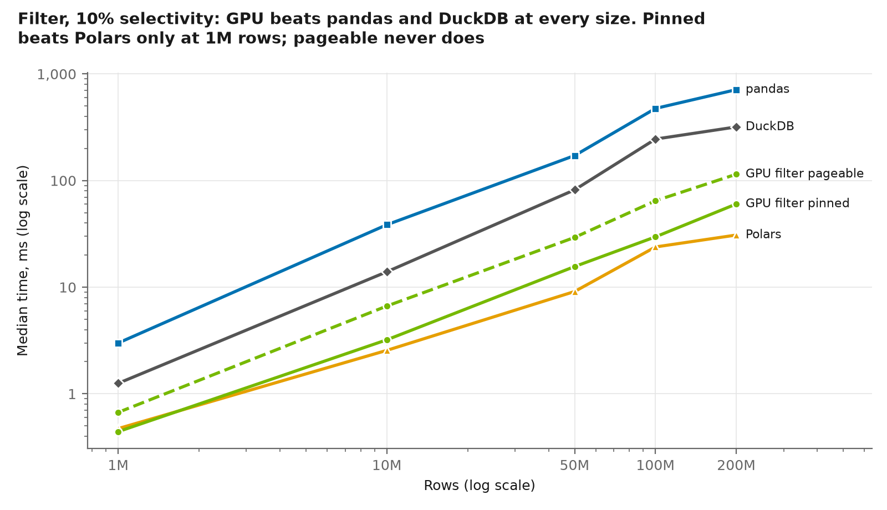
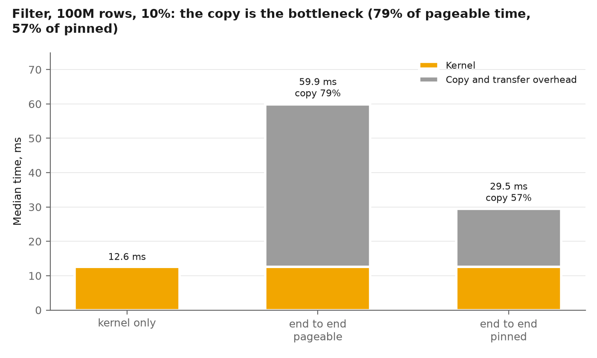

# gpu-analytics-engine

Hand-written CUDA filter and hash group-by kernels in CuPy RawKernel, benchmarked against pandas, Polars and DuckDB on an RTX 5060 Laptop GPU.

- Group-by, 100M rows, 1M groups: 119.3 ms on the GPU (block strategy, pinned), against 1,224.0 ms for Polars.
- Filter, 100M rows, 10% selectivity: the GPU kernels alone take 12.8 ms, against 23.8 ms for Polars. End to end, Polars wins, because the copies make the GPU take 29.7 ms with pinned memory.
- Group-by, 100M rows, 10 groups: the block kernel is 7.21x faster than the global kernel (12.4 ms against 89.6 ms).

## Results

All numbers are median times in milliseconds from `benchmarks/results/filter.csv` and `benchmarks/results/groupby.csv`. "Pinned" and "pageable" times include the copy to the GPU and back. "Kernel only" times start and end with the data already on the GPU (see Benchmark method).

### Filter: Polars wins end to end from 10M rows



The query is `value < threshold` on one int32 column, with 10% of the rows passing. The GPU filter (pinned) beats pandas and DuckDB at every size from 1M to 200M rows. Against Polars, it wins only at 1M rows: 0.442 ms against 0.472 ms. From 10M rows Polars wins: 23.8 ms against 29.7 ms at 100M rows, and 30.8 ms against 60.3 ms at 200M. With pageable memory, the GPU never beats Polars.

### Filter: the copies make Polars win



At 100M rows and 10% selectivity, the GPU kernels take 12.8 ms, against 23.8 ms for Polars. End to end, the same filter takes 64.7 ms with pageable memory and 29.7 ms with pinned memory. In other words, the copy and transfer overhead is 80% of the pageable time and 57% of the pinned time. The copy part is the end-to-end time minus the kernel-only time, so it also includes the allocation of the output.

The pinned times start with the data already in the pinned buffer. If the data starts in normal memory, the copy into the pinned buffer adds 21.2 ms. The pinned path then takes 50.9 ms, against 23.8 ms for Polars.

### Filter at 1% selectivity: Polars wins from 10M rows

At 1% selectivity, the GPU (pinned) beats Polars only at 1M rows (0.401 ms against 0.520 ms). From 10M rows Polars wins. At 100M rows Polars takes 12.3 ms. The GPU takes 28.7 ms end to end, and the kernels alone take 12.1 ms. Thus, at this selectivity the GPU kernels alone are about as fast as the complete Polars filter. The 16.5 ms of copy overhead comes on top.

### Group-by: GPU against the CPU engines


The query is `SELECT key, SUM(value), COUNT(*) GROUP BY key` on 100M rows with uniform keys. The GPU block strategy (pinned) beats every CPU engine at every group count. Against Polars, it takes 45.8 ms against 104.3 ms at 10 groups, and 119.3 ms against 1,224.0 ms at 1M groups. At 1K groups, Polars took from 114 to 545 ms over 3 runs (two modes, cause unknown). The GPU block pinned time of 43.8 ms beat it in every run, by at least 2.6x. The chart shows the CSV value for Polars, 344 ms.

### Where the group-by loses: the global strategy at 10 groups

The global strategy loses to Polars at 10 groups: 124.6 ms (pinned) against 104.3 ms. Its kernel alone takes 89.6 ms. With 10 groups, all threads do atomic adds on the same few table slots, so the hardware runs these adds one after another. The block strategy adds up the rows of each block in shared memory first, so the kernel time goes down to 12.4 ms.

### Group-by: block against global


These are kernel-only times at 100M rows. The block strategy is 7.21x faster than global at 10 groups with uniform keys and 6.33x faster with Zipf keys. At 1K groups it is 1.37x (uniform) and 1.59x (Zipf) faster. At 1M uniform groups it is about 5% slower (91.3 ms against 86.6 ms). Most of those rows do not find a place in the shared table and go to the global table anyway. At 1M Zipf groups the common keys stay in the shared table, so block is 3.08x faster.

## What is inside

The kernels are in `engine/`. Each file has one job.

- `engine/filter.py`: `filter_less_than(x, threshold, scan="own")`. Step 1 (flag) writes 1 for each row that passes and 0 for each row that does not. Step 2 is an exclusive prefix scan of the flags, which gives each passing row its position in the output. Step 3 (scatter) writes each passing row to that position, so the output stays in input order. With `scan="own"`, step 2 uses my own scan. With `scan="cub"`, it uses `cp.cumsum`, which runs NVIDIA CUB. The cumsum is inclusive, so the scatter subtracts 1 and no extra pass is needed.
- `engine/scan.py`: my own work-efficient (Blelloch) exclusive scan, as in GPU Gems 3, chapter 39. Each block of 256 threads scans 512 elements in shared memory. The block totals are then scanned with the same function (recursion) and added back to each block. Bank-conflict avoidance is left out to keep the code readable.
- `engine/groupby.py`: `group_by_sum_count(keys, values, expected_groups, strategy="global")`. It is a hash table with open addressing and linear probing, as in cuCollections `static_map`. The hash is the 32-bit MurmurHash3 finalizer (fmix32). The table size is the next power of two at or above 2 x `expected_groups`, so the load factor is at most 0.5. Sums are 64-bit, so int32 values cannot overflow.
  - `strategy="global"`: one thread per row, and one atomic update of the global table per row.
  - `strategy="block"`: each block takes 4,096 rows and first adds them up in a 1,024-slot table in shared memory (16 KB). After 32 probes without a free slot, a row goes straight to the global table. At the end, each key in the shared table goes to the global table once per block.
  - After the insert, the used slots are compacted with the same flag, scan and scatter steps as the filter.

## How I tested it

- Every kernel has a pytest check against pandas (filter and group-by) or NumPy (scan). The tests are in `tests/`, and 163 tests pass.
- The filter tests use 1, 255, 256, 257 and 1,000,000 rows (sizes around the 256-thread block). They use 0, 1, 10, 50, 90 and 100% selectivity, for both scan options.
- The scan tests also use 511, 512, 513 (around the 512-element block), 262,145 (three levels of recursion) and 100,000,000 elements.
- The group-by tests use 1 to 1,000,000 distinct keys, uniform and Zipf keys, and both strategies. Other tests cover the fallback from the shared table to the global table and a table that is too small (it must raise an error). They also cover input that must be rejected.
- `compute-sanitizer --tool memcheck` runs the full test suite with the CuPy memory pool off (`cupy.cuda.set_allocator(None)`). The pool rounds each allocation up to 512 bytes and hides small overruns. The result is 0 errors. The scan and the block group-by also pass racecheck (0 hazards), and the block group-by passes synccheck (0 errors).
- A limit of racecheck: it does not find races between shared-memory atomics and plain shared-memory reads. When I removed the second barrier in the block kernel, the count was wrong (3,947 of 4,096), but racecheck still reported 0 hazards. Thus, the pandas tests are the real check for the block kernel.

## Benchmark method

- Hardware: NVIDIA GeForce RTX 5060 Laptop GPU (sm_120, 8,151 MiB), Intel Core 9 270H, 31.7 GB RAM, Windows 11 Home. NVIDIA driver 621.24.
- Software: Python 3.14.7, CuPy (cupy-cuda13x) 14.2.0 with CUDA runtime 13.2, NumPy 2.5.5, pandas 3.1.1, Polars 2.2.0, DuckDB 2.0.1, pyarrow 26.0.1. compute-sanitizer is from CUDA toolkit 13.5. These versions were read on 2026-11-26.
- Data is made in memory with a fixed seed (`benchmarks/datagen.py`). Values are uniform int32 in [0, 1,000,000,000). Filter sizes are 1M, 10M, 50M, 100M and 200M rows, at 1, 10, 50 and 90% selectivity. Group-by sizes are 1M, 10M, 50M and 100M rows, with 10, 1K and 1M groups. Group keys are distinct random values in [0, 2^31 - 1), uniform or Zipf (a = 1.2).
- Each point does 3 warmup runs and then takes the median of 10 runs. The GPU is synchronized before and after each run.
- Each CPU engine gets its frame or table before the timer starts, so only the query is timed. Every engine sums int32 as int64 (Polars with `.cast(pl.Int64)`, DuckDB with `::BIGINT`). Every result is checked against pandas before it is timed.
- GPU modes: `kernel_only` starts and ends with the data on the GPU. `e2e_pageable` copies from and to normal NumPy memory. `e2e_pinned` copies from and to page-locked memory. The pinned input buffer is filled before the timer starts, as a pinned data loader would give it. Filling it from normal memory takes 21.2 ms at 100M rows (median of 10).
- The timed runs leave out the first call. In a fresh process with an empty kernel cache, at 100M rows, the first filter call took 169.4 ms (second call 12.3 ms). The first block group-by call took 3.7 s (second call 90.2 ms).
- The crossover point is the smallest row count from which the GPU wins at that size and at all larger sizes.
- All runs in the CSVs and charts used the Windows Best performance power mode on AC. Earlier runs in Balanced mode had the CPU at 800 to 900 MHz and made Polars up to 2x slower. They are in git history.
- Before each full run I checked free RAM with `Get-CimInstance Win32_OperatingSystem`, and stopped if it was below 5 GB. Free RAM was 11.4 GB for both runs.
- Known noise:
  - Polars at 1K uniform groups and 100M rows has two modes. Three runs gave 114.2, 137.4 and 544.7 ms, and the CSV has 344.3 ms. The cause is unknown.
  - At 1M rows the GPU pinned and Polars filter times differ by at most 0.12 ms.
  - `benchmarks/results/filter_noisy_run1.csv` is an old run with only 3.4 GB RAM free and is not used in the charts.

## Limits

- Keys and values are int32 only. Other types need new kernels.
- Scan positions are int32, so one call can take at most 2^31 - 1 rows.
- The GPU has 8 GB of memory. The group-by table needs 24 bytes per slot, so about 2^27 groups fit. The group-by raises MemoryError before it allocates a table that is too big. This memory check does not count the inputs or the outputs.
- The caller must give `expected_groups`. A value that is too low raises an error, and a value that is too high wastes memory. The group-by output is in hash order, not key order.
- At 1M uniform groups and 100M rows, an `expected_groups` value 2x too high made the block kernel 1.93x slower. A value 10x too high made it 2.46x slower. This was one run, outside the CSVs.
- This is a laptop GPU. A desktop card or a data-center GPU may give different crossover points.
- All results come from one machine. I did not repeat them on other hardware.

## How to run

Run from the project root in PowerShell. You need an NVIDIA GPU and a driver that supports CUDA 13.

```
python -m venv C:\venvs\gpu-analytics-engine
C:\venvs\gpu-analytics-engine\Scripts\Activate.ps1
pip install cupy-cuda13x==14.2.0 numpy pandas polars duckdb pyarrow pytest matplotlib
python check_gpu.py
pytest
python -m benchmarks.bench_filter
python -m benchmarks.bench_groupby
python -m benchmarks.plot
```

- `check_gpu.py` must print the GPU name, the compute capability (for example `sm_120`) and `True` before any other work.
- `pytest tests\test_filter.py::test_filter_matches_pandas` runs one test function (60 cases).
- The benchmarks write `benchmarks/results/filter.csv` and `groupby.csv`. `plot.py` reads them and writes the four charts to `docs/figures/`. The chart titles are fixed text, so check them after a new run.

## References

I read and cited these. The code in this repo is my own.

- [NVIDIA/cuda-samples, scan sample](https://github.com/NVIDIA/cuda-samples/tree/master/cpp/2_Concepts_and_Techniques/scan)
- [NVIDIA/cccl, CUB device scan (`cub/cub/device/device_scan.cuh`)](https://github.com/NVIDIA/cccl/blob/main/cub/cub/device/device_scan.cuh)
- [NVIDIA/cuCollections, `static_map`](https://github.com/NVIDIA/cuCollections/blob/dev/include/cuco/static_map.cuh), [linear probing (`probing_scheme.cuh`)](https://github.com/NVIDIA/cuCollections/blob/dev/include/cuco/probing_scheme.cuh) and [shared-memory example](https://github.com/NVIDIA/cuCollections/blob/dev/examples/static_set/shared_memory_example.cu)
- [GPU Gems 3, chapter 39: Parallel Prefix Sum (Scan) with CUDA](https://developer.nvidia.com/gpugems/gpugems3/part-vi-gpu-computing/chapter-39-parallel-prefix-sum-scan-cuda) (Harris, Sengupta, Owens)

## License

MIT. See [LICENSE](LICENSE).
