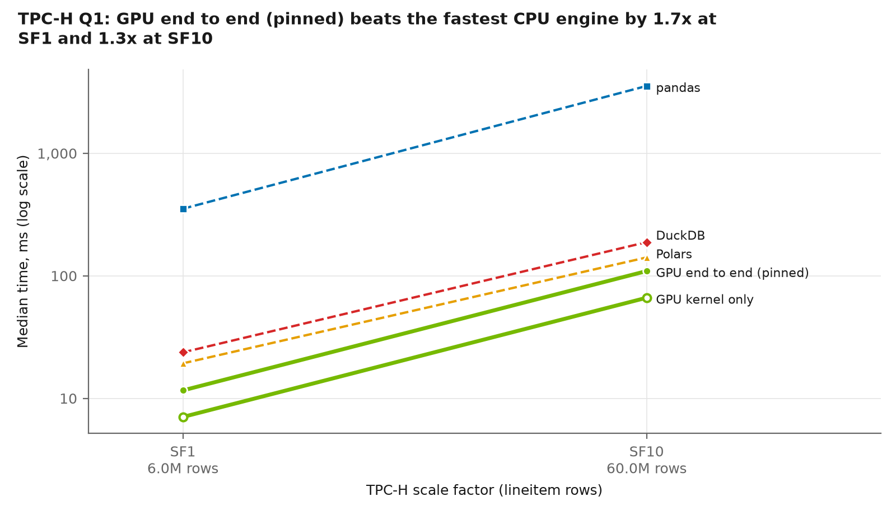
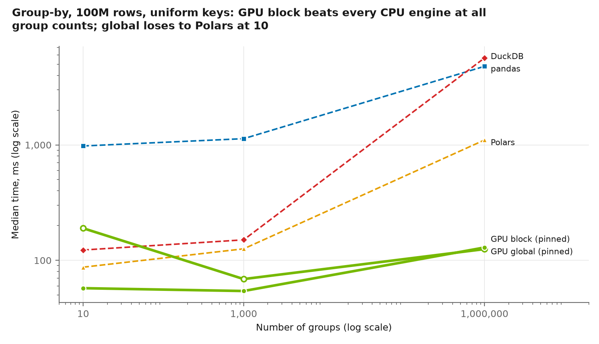
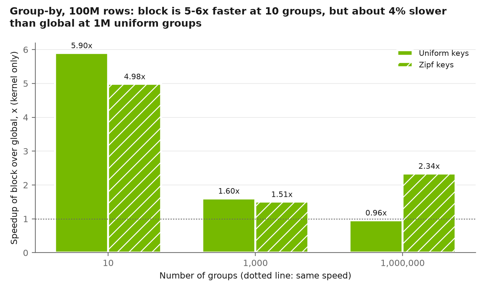

# gpu-analytics-engine

Hand-written CUDA filter, hash group-by and TPC-H Q1 kernels in CuPy RawKernel, benchmarked against pandas, Polars and DuckDB on an RTX 5060 Laptop GPU.

Status: frozen on 2026-11-27. No new features.

- TPC-H Q1, SF10 (59,986,052 rows): 109.3 ms on the GPU end to end (pinned), against 141.3 ms for Polars and 188.2 ms for DuckDB.
- Group-by, 100M rows, 1M groups: 129.2 ms on the GPU (block strategy, pinned), against 1,102.6 ms for Polars.
- Filter, 100M rows, 10% selectivity: Polars wins. It takes 15.5 ms. The GPU takes 42.6 ms end to end (pinned), and its kernels alone take 21.6 ms.
- Group-by, 100M rows, 10 groups: the block kernel is 5.90x faster than the global kernel (27.0 ms against 159.4 ms).

## The GPU clock is locked at 945 MHz

All GPU times in the CSVs and charts were measured with the SM clock locked at 945 MHz and the memory clock at 12001 MHz (`nvidia-smi -lgc 945,945` and `nvidia-smi -lmc 12001,12001`, as administrator).

- Reason: at stock clocks, the laptop GPU changed its clock from run to run (power states P8 and P4), and some group-by times changed by 60 to 77% between runs. With the lock, the times are repeatable.
- Cost: the locked times are slower than at stock clocks. For example, the block group-by kernel at 10 groups takes 27.0 ms locked and 12.4 ms at stock clocks. Thus, compare the GPU numbers with each other and with the CPU engines on this machine, not with other GPU benchmarks.
- Check: nvidia-smi logged the clocks every 100 ms during each timing run. A sample counted as on the lock at 937, 945 or 952 MHz (the supported steps nearest 945) and 12001 MHz memory. The first 1.0 s of each window is skipped (the warmup moves the card from P4 to P0). Results: a soak of 1,090 samples with 0 off the lock; group-by 144 windows with 0 off (32 windows were shorter than 1 s and had no samples); Q1 4 windows with 0 off; filter 13 cells off, of which 10 were run again on the lock. 3 filter cells stay off the lock (see `docs/known-issues.md`).
- The CPU engines do not depend on the GPU clock.
- To remove the lock: `nvidia-smi -rgc` and `nvidia-smi -rmc` (as administrator).

## Results

All numbers are median times in milliseconds from `benchmarks/results/filter.csv`, `groupby.csv` and `tpch_q1.csv`. "Pinned" and "pageable" times include the copy to the GPU and back. "Kernel only" times start and end with the data already on the GPU (see Benchmark method). GPU filter numbers use my own scan (scan="own") unless stated.

### TPC-H Q1: the GPU wins end to end at SF1 and SF10



Q1 filters lineitem on the ship date, groups by (returnflag, linestatus), and computes 4 sums, 3 averages and a count. The GPU (pinned) beats every CPU engine at both sizes:

- SF1 (6,001,215 rows): GPU 11.6 ms (kernel only 7.0 ms), Polars 19.3 ms, DuckDB 23.7 ms, pandas 352.7 ms. The GPU is 1.66x faster than Polars.
- SF10 (59,986,052 rows): GPU 109.3 ms (kernel only 66.2 ms), Polars 141.3 ms, DuckDB 188.2 ms, pandas 3,544.2 ms. The GPU is 1.29x faster than Polars.

The win gets smaller as the data gets bigger. At SF10, the copy to the GPU (1,139.7 MB, 6 columns) takes about 43 ms of the 109.3 ms (Nsight Systems). With pageable memory, or with the encoding counted, the GPU would lose more of its lead. I did not measure those cases for Q1.

How the kernel works and what is timed:

- One fused kernel (`q1_block`) does the filter and the group-by. The group id has only 6 possible values (returnflag A, N or R times linestatus F or O), so each block keeps 36 sums (6 groups x 6 aggregates) in shared memory, indexed directly by group id. It needs no hash table. This is the same block pre-aggregation as the block group-by: each block adds up 4,096 rows in shared memory, then does one global atomic add per non-zero sum.
- The columns are encoded once, before the timers, for all engines: price in cents (int64), quantity, discount and tax in hundredths (int16), ship date in days (int32), group id (uint8). That is 19 bytes per row. Every engine gets the same encoded integer columns and computes the products, sums and averages inside its timed query. The encoding itself is not timed for any engine.
- Every engine's result is checked against DuckDB's own Q1 answer on the original table before it is timed.
- Overflow: at SF10 the largest sum is sum_charge, 6,799,146,657,523,920,000, which is 0.737 of 2^63. Thus the int64 sums are safe at SF10 but not much above it.
- Threads: pandas 1, Polars 20, DuckDB 20.

### Filter: Polars wins end to end from 10M rows


The query is `value < threshold` on one int32 column, with 10% of the rows passing. The GPU filter (pinned) beats pandas and DuckDB at every size from 1M to 200M rows. Against Polars, it wins only at 1M rows: 0.533 ms against 0.848 ms (pageable: 0.681 ms). From 10M rows Polars wins: 2.2 ms against 4.2 ms at 10M, 15.5 ms against 42.6 ms at 100M, and 29.8 ms against 75.8 ms at 200M. Thus there is no crossover point against Polars: the GPU wins at the smallest size and loses at every larger size.

### Filter: the copies are most of the GPU time


At 100M rows and 10% selectivity, the GPU kernels take 21.6 ms. End to end, the same filter takes 66.0 ms with pageable memory and 42.6 ms with pinned memory. In other words, the copy and transfer overhead is 67% of the pageable time and 49% of the pinned time. The copy part is the end-to-end time minus the kernel-only time, so it also includes the allocation of the output. At the locked clock, Polars (15.5 ms) is faster than my own kernels alone. With CUB's scan the kernels take 13.4 ms, but the pinned time is still 34.2 ms.

The pinned times start with the data already in the pinned buffer. In the stock-clock run (before the lock), the copy from normal memory into the pinned buffer took 21.2 ms at 100M rows. I did not measure it again under the lock.

### Filter at 1% selectivity: Polars wins at every size

At 1% selectivity, Polars beats the GPU (pinned) at every size, also at 1M rows (0.403 ms against 0.479 ms). At 100M rows Polars takes 10.7 ms. The GPU takes 40.2 ms end to end, and the kernels alone take 20.8 ms (12.7 ms with CUB's scan).

### Group-by: GPU against the CPU engines



The query is `SELECT key, SUM(value), COUNT(*) GROUP BY key` on 100M rows with uniform keys. The GPU block strategy (pinned) beats every CPU engine at every group count. Against Polars, it takes 57.4 ms against 87.3 ms at 10 groups, 54.3 ms against 125.9 ms at 1K groups, and 129.2 ms against 1,102.6 ms at 1M groups. With Zipf keys at 1K groups, Polars took 731.4 ms and DuckDB 130.2 ms. I did not measure why Polars is slower there.

### Where the group-by loses: the global strategy at 10 groups

The global strategy loses to Polars and DuckDB at 10 groups: 189.7 ms (pinned) against 87.3 ms and 122.9 ms. Its kernel alone takes 159.4 ms. With 10 groups, all threads do atomic adds on the same few table slots, so the hardware runs these adds one after another. The block strategy adds up the rows of each block in shared memory first, so the kernel time goes down to 27.0 ms.

### Group-by: block against global



These are kernel-only times at 100M rows. The block strategy is 5.90x faster than global at 10 groups with uniform keys and 4.98x faster with Zipf keys. At 1K groups it is 1.60x (uniform) and 1.51x (Zipf) faster. At 1M uniform groups it is about 4% slower (98.0 ms against 94.1 ms). Most of those rows do not find a place in the shared table and go to the global table anyway. At 1M Zipf groups the common keys stay in the shared table, so block is 2.34x faster (33.0 ms against 77.2 ms).

## Profiling

Nsight Systems and Nsight Compute results are in [docs/profiling.md](docs/profiling.md). For Q1 at SF10, under the lock:

- Each run is 1 kernel launch, 1 memset, 6 copies to the GPU (1,139.7 MB) and 1 copy back (288 bytes).
- `q1_block` uses 4.90% of the DRAM bandwidth (17.4 GB/s). It is limited by the L1/shared-memory pipe (81.7%), where the shared atomic adds run, and by SM issue (74.7%), not by memory. A faster kernel needs fewer shared atomics per row, not fewer bytes.

## What is inside

The kernels are in `engine/`. Each file has one job.

- `engine/filter.py`: `filter_less_than(x, threshold, scan="own")`. Step 1 (flag) writes 1 for each row that passes and 0 for each row that does not. Step 2 is an exclusive prefix scan of the flags, which gives each passing row its position in the output. Step 3 (scatter) writes each passing row to that position, so the output stays in input order. With `scan="own"`, step 2 uses my own scan. With `scan="cub"`, it uses `cp.cumsum`, which runs NVIDIA CUB. The cumsum is inclusive, so the scatter subtracts 1 and no extra pass is needed. At 100M rows and 10% selectivity, CUB's scan makes the filter 8.2 ms faster than my own scan with kernel only (13.4 ms against 21.6 ms) and 8.4 ms faster end to end with pinned memory (34.2 ms against 42.6 ms).
- `engine/scan.py`: my own work-efficient (Blelloch) exclusive scan, as in GPU Gems 3, chapter 39. Each block of 256 threads scans 512 elements in shared memory. The block totals are then scanned with the same function (recursion) and added back to each block. Bank-conflict avoidance is left out to keep the code readable.
- `engine/groupby.py`: `group_by_sum_count(keys, values, expected_groups, strategy="global")`. It is a hash table with open addressing and linear probing, as in cuCollections `static_map`. The hash is the 32-bit MurmurHash3 finalizer (fmix32). The table size is the next power of two at or above 2 x `expected_groups`, so the load factor is at most 0.5. Sums are 64-bit, so int32 values cannot overflow.
  - `strategy="global"`: one thread per row, and one atomic update of the global table per row.
  - `strategy="block"`: each block takes 4,096 rows and first adds them up in a 1,024-slot table in shared memory (16 KB). After 32 probes without a free slot, a row goes straight to the global table. At the end, each key in the shared table goes to the global table once per block.
  - After the insert, the used slots are compacted with the same flag, scan and scatter steps as the filter.
- `engine/q1.py`: `q1_sums(...)` runs the fused `q1_block` kernel (see the Q1 section), and `q1_rows(...)` computes the 3 averages on the host from the sums.
- `benchmarks/tpch_data.py`: makes the TPC-H data with DuckDB (`CALL dbgen(sf=...)`), saves it in `C:\data\gpu-analytics-engine`, encodes the Q1 columns, and saves DuckDB's Q1 answer as the reference.

## How I tested it

- Every kernel has a pytest check against pandas (filter and group-by), NumPy (scan) or DuckDB (Q1). The tests are in `tests/`, and 171 tests pass.
- The filter tests use 1, 255, 256, 257 and 1,000,000 rows (sizes around the 256-thread block). They use 0, 1, 10, 50, 90 and 100% selectivity, for both scan options.
- The scan tests also use 511, 512, 513 (around the 512-element block), 262,145 (three levels of recursion) and 100,000,000 elements.
- The group-by tests use 1 to 1,000,000 distinct keys, uniform and Zipf keys, and both strategies. Other tests cover the fallback from the shared table to the global table and a table that is too small (it must raise an error). They also cover input that must be rejected.
- The Q1 tests compare the kernel with DuckDB's Q1 answer at SF0.01 and SF1. Two more cases are checked against pandas: no rows pass the date filter, and one group with 1, 4,095, 4,096, 4,097 and 100,000 rows (sizes around the 4,096 rows of one block).
- `compute-sanitizer --tool memcheck` runs the full test suite with the CuPy memory pool off (`cupy.cuda.set_allocator(None)`). The pool rounds each allocation up to 512 bytes and hides small overruns. The result is 0 errors. The scan and the block group-by also pass racecheck (0 hazards), and the block group-by passes synccheck (0 errors). For Q1, the three tools ran on `tests/test_q1.py` only: memcheck 0 errors, racecheck 0 hazards, synccheck 0 errors.
- A limit of racecheck: it does not find races between shared-memory atomics and plain shared-memory reads. When I removed the second barrier in the block kernel, the count was wrong (3,947 of 4,096), but racecheck still reported 0 hazards. Thus, the pandas tests are the real check for the block kernels.

## Benchmark method

- Hardware: NVIDIA GeForce RTX 5060 Laptop GPU (sm_120, 8,151 MiB, 55 W), Intel Core 9 270H, 31.7 GB RAM, Windows 11 Home. NVIDIA driver 621.24. SM clock locked at 945 MHz and memory at 12001 MHz (see above).
- Software: Python 3.14.7, CuPy (cupy-cuda13x) 14.2.0 with CUDA runtime 13.2, NumPy 2.5.5, pandas 3.1.1, Polars 2.2.0, DuckDB 2.0.1, pyarrow 26.0.1. compute-sanitizer is from CUDA toolkit 13.5. These versions were read on 2026-11-26. Exact versions are in `requirements.txt`.
- Filter and group-by data is made in memory with a fixed seed (`benchmarks/datagen.py`). Values are uniform int32 in [0, 1,000,000,000). Filter sizes are 1M, 10M, 50M, 100M and 200M rows, at 1, 10, 50 and 90% selectivity. Group-by sizes are 1M, 10M, 50M and 100M rows, with 10, 1K and 1M groups. Group keys are distinct random values in [0, 2^31 - 1), uniform or Zipf (a = 1.2).
- Q1 data is TPC-H lineitem from DuckDB's `dbgen` at SF1 and SF10, stored outside the repo in `C:\data\gpu-analytics-engine`.
- Each point does 3 warmup runs and then takes the median of 10 runs. The GPU is synchronized before and after each run.
- Each CPU engine gets its frame or table before the timer starts, so only the query is timed. Every engine sums int32 as int64 (Polars with `.cast(pl.Int64)`, DuckDB with `::BIGINT`). Every result is checked before it is timed: against pandas for the filter and group-by, against DuckDB's Q1 answer for Q1.
- GPU modes: `kernel_only` starts and ends with the data on the GPU. `e2e_pageable` copies from and to normal NumPy memory. `e2e_pinned` copies from and to page-locked memory. The pinned input buffer is filled before the timer starts, as a pinned data loader would give it. Q1 has only `kernel_only` and `e2e_pinned`.
- The timed runs leave out the first call. In the stock-clock run (before the lock), in a fresh process with an empty kernel cache, at 100M rows, the first filter call took 169.4 ms (second call 12.3 ms). The first block group-by call took 3.7 s (second call 90.2 ms).
- The crossover point is the smallest row count from which the GPU wins at that size and at all larger sizes.
- All runs used the Windows Best performance power mode on AC. Earlier runs in Balanced mode had the CPU at 800 to 900 MHz and made Polars up to 2x slower. They are in git history.
- Before each run I checked free RAM (stop below 5 GB), the Best performance overlay, AC power, and that no other process used more than 5% CPU. Some gate outputs were not saved (see `docs/known-issues.md`).
- Known noise:
  - Polars on the filter at 100M rows, 10%, took 23.8 ms in the stock-clock run and 15.5 ms in the locked run (-35%). Polars does not use the GPU, so the lock does not explain it. I did not measure the cause.
  - In the stock-clock run, Polars at 1K uniform groups and 100M rows had two modes (114.2, 137.4 and 544.7 ms in three runs). The locked run gave 125.9 ms.
  - `benchmarks/results/filter_noisy_run1.csv` is an old run with only 3.4 GB RAM free and is not used in the charts.

## Limits

- Keys and values are int32 only. Other types need new kernels.
- Scan positions are int32, so one call can take at most 2^31 - 1 rows.
- The GPU has 8 GB of memory. The group-by table needs 24 bytes per slot, so about 2^27 groups fit. The group-by raises MemoryError before it allocates a table that is too big. This memory check does not count the inputs or the outputs.
- The caller must give `expected_groups`. A value that is too low raises an error, and a value that is too high wastes memory. The group-by output is in hash order, not key order.
- At 1M uniform groups and 100M rows, an `expected_groups` value 2x too high made the block kernel 1.93x slower. A value 10x too high made it 2.46x slower. This was one run at stock clocks, outside the CSVs.
- Q1: the group ids are fixed to the 6 TPC-H (returnflag, linestatus) pairs, and the largest int64 sum is at 0.737 of 2^63 at SF10. A bigger scale factor needs wider sums.
- Copy speed: in Nsight Systems (session 1, stock clocks) the filter copy to the GPU ran at 26.4 GB/s and the group-by copy at 22.2 GB/s. I did not find the cause of this 16% gap.
- Nsight Compute reports the DRAM clock as 8.99 GHz in session 1 (stock clocks) and 11.99 GHz under the lock. The DRAM % of peak uses that clock, so the DRAM % values of the two sessions are not directly comparable.
- The times are at a locked 945 MHz SM clock, which is slower than stock. This is a laptop GPU. A desktop card or a data-center GPU may give different crossover points.
- All results come from one machine. I did not repeat them on other hardware.

## How to run

Run from the project root in PowerShell. You need an NVIDIA GPU and a driver that supports CUDA 13.

```
python -m venv C:\venvs\gpu-analytics-engine
C:\venvs\gpu-analytics-engine\Scripts\Activate.ps1
pip install -r requirements.txt
python check_gpu.py
python -m benchmarks.tpch_data
pytest
python -m benchmarks.bench_filter
python -m benchmarks.bench_groupby
python -m benchmarks.bench_q1
python -m benchmarks.plot
python -m benchmarks.plot_q1
```

- `check_gpu.py` must print the GPU name, the compute capability (for example `sm_120`) and `True` before any other work.
- `benchmarks.tpch_data` makes the TPC-H data at SF0.01, SF1 and SF10 in `C:\data\gpu-analytics-engine`. The Q1 tests need SF0.01 and SF1.
- `pytest tests\test_filter.py::test_filter_matches_pandas` runs one test function (60 cases).
- The benchmarks write `benchmarks/results/filter.csv`, `groupby.csv` and `tpch_q1.csv`. `plot.py` writes the four filter and group-by charts and `plot_q1.py` writes the Q1 chart to `docs/figures/`. The filter and group-by chart titles are fixed text, so check them after a new run.
- To get the same clocks as the CSVs, lock them first as administrator (`nvidia-smi -lgc 945,945` and `nvidia-smi -lmc 12001,12001`), and remove the lock after (`nvidia-smi -rgc` and `nvidia-smi -rmc`).

## References

References and related work. The code in this repo is my own.

- [NVIDIA/cuda-samples, scan sample](https://github.com/NVIDIA/cuda-samples/tree/master/cpp/2_Concepts_and_Techniques/scan)
- [NVIDIA/cccl, CUB device scan (`cub/cub/device/device_scan.cuh`)](https://github.com/NVIDIA/cccl/blob/main/cub/cub/device/device_scan.cuh)
- [NVIDIA/cuCollections, `static_map`](https://github.com/NVIDIA/cuCollections/blob/dev/include/cuco/static_map.cuh), [linear probing (`probing_scheme.cuh`)](https://github.com/NVIDIA/cuCollections/blob/dev/include/cuco/probing_scheme.cuh) and [shared-memory example](https://github.com/NVIDIA/cuCollections/blob/dev/examples/static_set/shared_memory_example.cu)
- [GPU Gems 3, chapter 39: Parallel Prefix Sum (Scan) with CUDA](https://developer.nvidia.com/gpugems/gpugems3/part-vi-gpu-computing/chapter-39-parallel-prefix-sum-scan-cuda) (Harris, Sengupta, Owens)
- [NVIDIA/cudf](https://github.com/NVIDIA/cudf), GPU DataFrame library (RAPIDS)
- [anilshanbhag/crystal](https://github.com/anilshanbhag/crystal), GPU library for SQL queries

## License

MIT. See [LICENSE](LICENSE).

