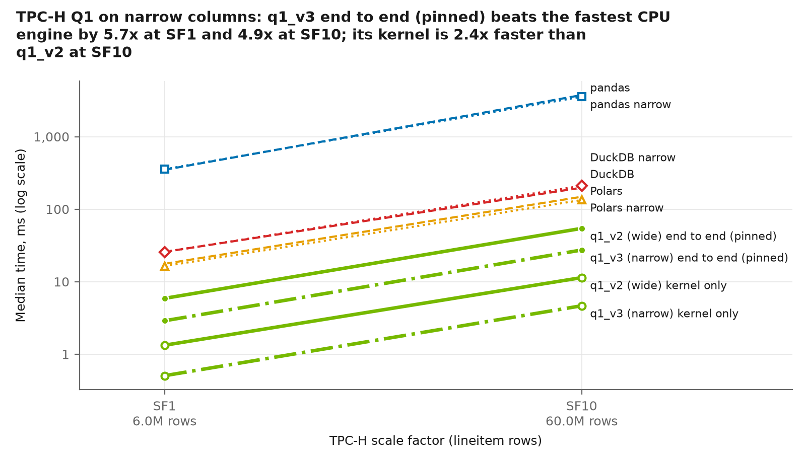
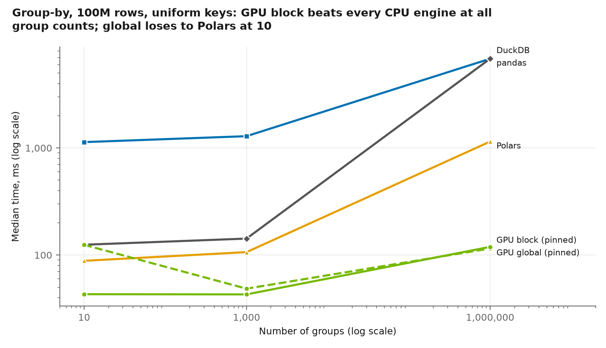
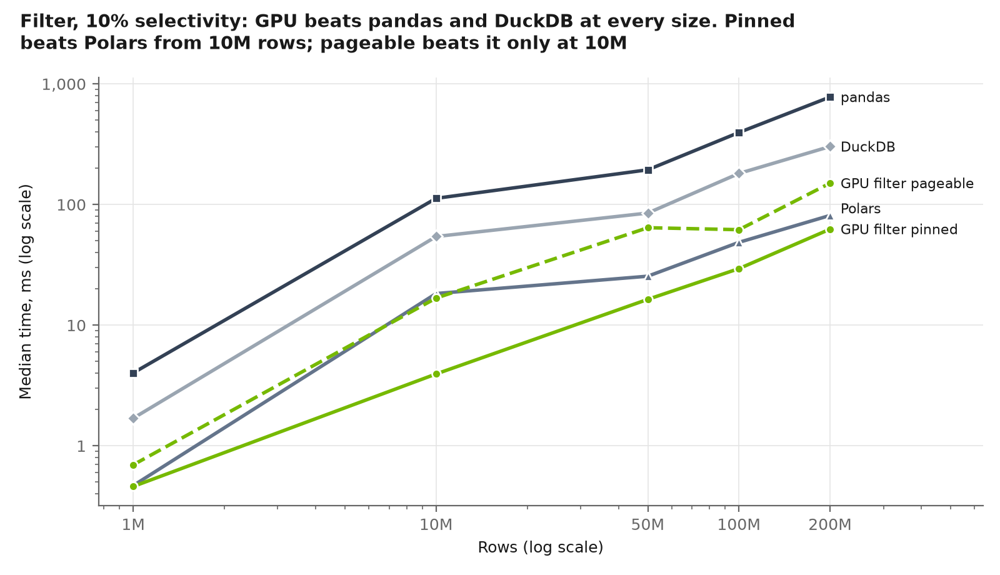
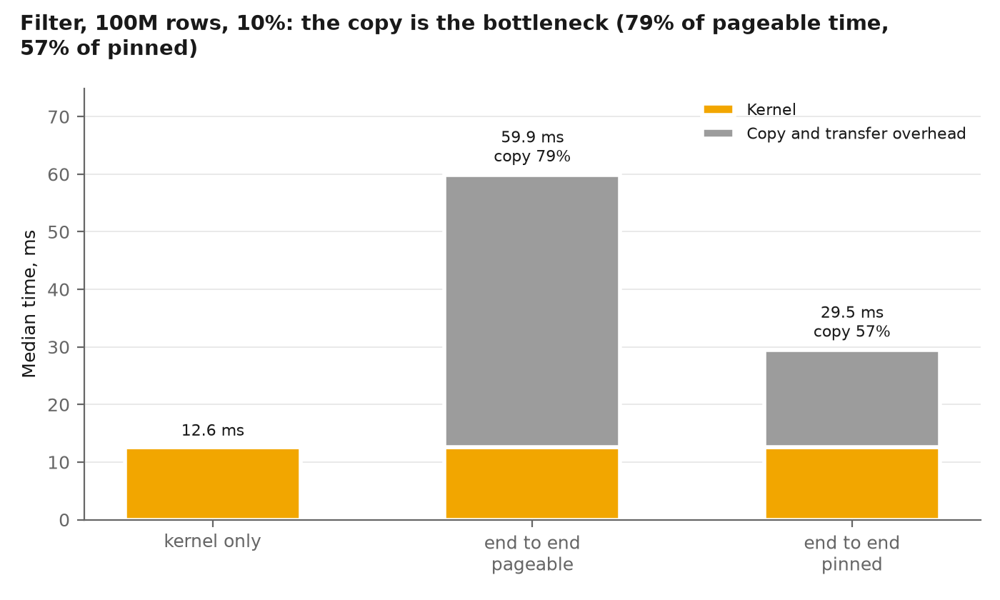

# GPU Analytics Engine, explained simply

This is the plain-language version of the [main README](README.md). It needs no computer science background. Every number here comes from the main README.

## What this project is

I wrote small programs that run on a laptop graphics card (a GPU) and answer questions about very large tables of data, the kind of work a company does when it adds up millions of sales. Then I raced them against three popular data tools that run on the normal processor (the CPU): pandas, Polars and DuckDB.

The question was simple: when is the graphics card faster, and when is it not?

## Why use a graphics card for data?

A CPU has a small number of strong workers. A GPU has thousands of simpler workers that all do the same step at the same time. Graphics cards were built to colour millions of pixels at once, and the same idea works for millions of rows in a table: give each worker a few rows and let them all go at once.

There is a catch. The graphics card has its own memory, separate from the computer's main memory. Before it can do anything, the data has to be copied over to it, and the answer has to be copied back. Think of a very fast kitchen in another building: the cooking is quick, but every ingredient has to be driven over first.

On this laptop, that copy runs at about 26.5 GB per second. For many jobs, the copy takes longer than the work itself. That one fact explains most of the results below.

## The three jobs

1. Filter: "find every row where the value is below some number." For example, pick out every receipt under $10 from 100 million receipts.
2. Group-by: "add up the values for each category." For example, total sales for each store, with anywhere from 10 to 1 million stores.
3. TPC-H Q1: a standard business report used across the industry to test databases. It takes a table of about 60 million order items and, for each combination of "was it returned?" and "has it shipped?", adds up the quantity, the price, the price after discount and the price after discount plus tax, and works out the averages.

The three tools it raced against:

- pandas: the most common data tool in Python. It uses one worker.
- Polars: a newer, much faster tool. It used 20 workers here.
- DuckDB: a small, fast database. It also used 20 workers here.

## The results

Times are in milliseconds (ms). 1,000 ms is one second. Lower is better. "End to end" means the full trip, including the copy to the graphics card and back.

- The business report (TPC-H Q1, about 60 million rows): the graphics card took 27.3 ms end to end. Polars took 133.6 ms and DuckDB 209.6 ms. The graphics card was about 4.9 times faster than the fastest other tool.
- Group-by with 1 million categories (100 million rows): the graphics card took 129.2 ms. Polars took 1,102.6 ms, so the graphics card was about 8.5 times faster.
- Filter (100 million rows): Polars won. It took 15.5 ms. The graphics card took 42.6 ms end to end, and about half of that was just the copy.

Why does the filter lose? A filter does very little work per row: one comparison. So the copy is most of the time, and a fast CPU tool that never has to copy anything finishes first. The report and the group-by do much more work per row, so the time the graphics card saves is bigger than the time the copy costs.

The charts below show the same results. The time axes are log scales: each grid line is 10 times the one before it, so a gap that looks small can be large. "Pinned" and "pageable" are two ways of holding the data in the computer's memory before the copy. Pinned memory copies to the graphics card faster.

The business report, at two sizes. Shorter bars are faster. "Kernel only" leaves out the copy; "end to end" includes it.

The group-by, from 10 to 1 million categories. The two green lines are two versions of my graphics card program. Both stay below every other tool.

The filter, from 1 million to 200 million rows. From 10 million rows on, Polars (the orange dashed line) sits below both green lines, so it finishes first.

Where the filter time goes on the graphics card at 100 million rows. Green is the work itself and grey is the copy.

## How the report got 4 times faster

I wrote the report program three times. Each time, I used NVIDIA's measuring tools (called Nsight) to see what was slow, then fixed that one thing.

1. Version 1 took 109.1 ms. The measuring tool showed the workers were constantly waiting their turn to write on the same shared tally sheet: 296.8 million times in one run.
2. Version 2 took 54.3 ms. Each worker now keeps its own private tally and only combines it with the others at the very end. The waiting dropped from 296.8 million times to 9,994.
3. Version 3 took 27.3 ms. Now the copy was the slow part, so I made each row smaller. A discount can only be 0 to 10, so it doesn't need a big box to store it. Each row went from 19 bytes to 10, which halved the copy, and each worker now picks up 4 rows at a time instead of 1.

## How I know the numbers are right

Every timed run goes through the same steps, from the checks before it starts to the final chart:

- Every answer is checked against a trusted answer (from pandas or DuckDB) before its time counts. A fast wrong answer is thrown out.
- 200 automated tests check the programs, including awkward cases like empty results or row counts that don't divide evenly.
- NVIDIA's compute-sanitizer tool checked the programs for memory mistakes and found 0 errors.
- Every time is the middle value of 10 runs, after 3 warm-up runs.
- The other tools got the same smaller 10-byte rows as version 3, so the race was fair.
- A laptop graphics card speeds up and slows down on its own, depending on heat and power. At first that changed some times by 60 to 77% between runs. So I locked its speed at 945 MHz and checked the speed during every run. That makes the times slower than the card's normal speed, but they repeat.

## Limits

- Everything was measured on one laptop. A desktop or server graphics card would give different numbers.
- The data was prepared in advance (turned into whole numbers), and that preparation is not timed for any tool.
- The programs only handle whole numbers.
- Some small questions are still open, such as why the copy to the graphics card ran 16% slower for the group-by than for the filter. They are listed in [docs/known-issues.md](docs/known-issues.md).
- The project is finished (version 1.2.0, 2026-11-28). No new features are planned.

## Words used here

- CPU: the computer's main processor. A few strong workers.
- GPU or graphics card: thousands of simpler workers that do the same step at once.
- CUDA: NVIDIA's language for writing programs that run on its graphics cards.
- Kernel: one program that runs on the graphics card. "Kernel only" times leave out the copy.
- Copy (H2D and D2H): moving data from the computer to the graphics card (host to device) and back (device to host).
- Row: one line of a table, like one receipt.
- Pinned and pageable memory: two ways of holding data in the computer's memory. Pinned memory copies to the graphics card faster.
- ms: millisecond, one thousandth of a second.
- TPC-H: a standard set of business questions and data used to compare databases. SF10 means its 10x size, about 60 million order items.

## Tools used

Python, CUDA (through CuPy), NVIDIA Nsight Systems and Nsight Compute, compute-sanitizer, pytest, pandas, Polars, DuckDB and matplotlib.

For the full method, every measurement and the code, see the [main README](README.md).
